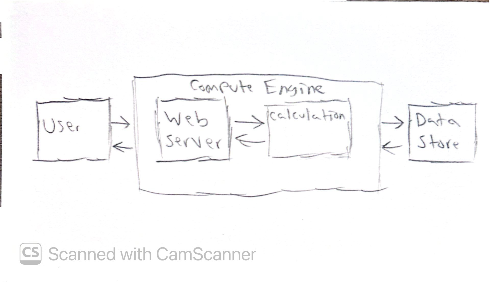

# Dakotas_Software_Engineering_Repo
#Computation system design:
#Finding the amount of solutions to a user inputed perimeter. The program uses a nested loop to go through every possible {a,b,c} solution, and if a+b+c = the perimeter, the number of solutions gets incrimented by 1.  
#